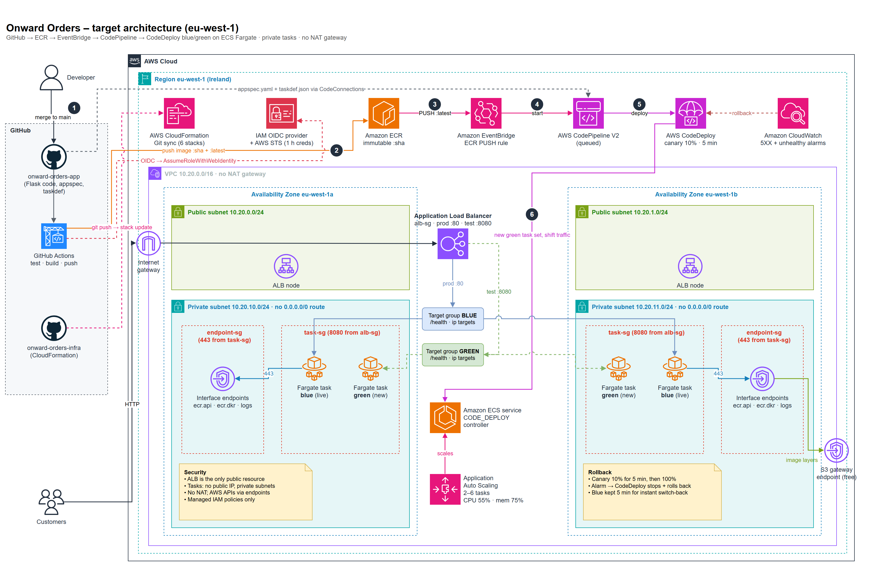

# Architecture: Onward Orders on AWS

Files:

- [architecture.drawio](architecture.drawio): the editable source. Open it in draw.io (app.diagrams.net or the desktop app).
- [architecture.svg](architecture.svg): the vector version, sharp at any size.
- [architecture.png](architecture.png): the picture shown above.

To rebuild all three, run `python docs/report-src/build_architecture_drawio.py`. It needs internet access, because the export uses draw.io's own viewer.

## Numbered flow of a change

1. A developer merges to `main` in **onward-orders-app**. This is the only manual step.
2. **GitHub Actions** runs the tests, then assumes `onward-orders-lab-github-actions-role` through **OIDC**. It gets temporary STS credentials, with no stored keys. It builds the image and pushes `:<sha>` (immutable) and `:latest` to **ECR**.
3. ECR emits an **ECR Image Action PUSH** event for `latest`.
4. The **EventBridge** rule starts **CodePipeline**. There is no polling.
5. The pipeline collects the image URI from ECR, plus `appspec.yaml` and `taskdef.json` from the app repo. It then registers a new task definition revision and calls **CodeDeploy**.
6. **CodeDeploy** starts a green task set in the private subnets of both AZs and registers it in the idle target group. It shifts 10% of production traffic for 5 minutes, then 100%. If a 5XX or unhealthy-host alarm fires, it rolls back automatically. The old tasks stay up 5 minutes for a fast rollback, then terminate.

## Security boundaries

- The **ALB** is the only public resource. Tasks get no public IP, and private route tables have no `0.0.0.0/0` route. There is no NAT gateway.
- Security groups are chained: `alb-sg` reaches `task-sg` on 8080 only. `task-sg` reaches `endpoint-sg` and the S3 prefix list on 443 only. `endpoint-sg` accepts 443 only from `task-sg`.
- IAM uses managed policies only. The GitHub role is trusted only for `repo:Ndaziramiyep/onward-orders-app:ref:refs/heads/main`.
